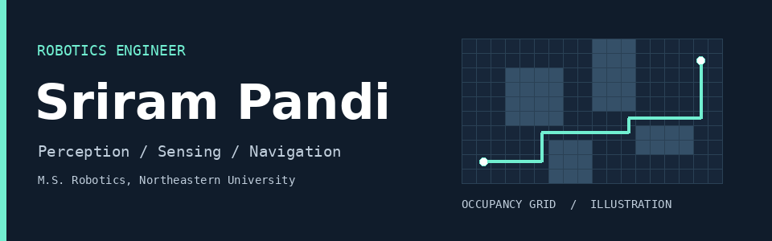

# Sriram Pandi

I work across **robot perception, sensor characterization, and autonomous navigation**. My engineering experience includes LiDAR point clouds and 3D alignment. I hold an M.S. in Robotics from Northeastern University.

[LinkedIn](https://www.linkedin.com/in/sriram-pandi/) · [All repositories](https://github.com/Sriram-Pandi?tab=repositories)

## Featured projects

| Project | What to explore |
| :--- | :--- |
| [**Assistive Feeding Robot**](https://github.com/Sriram-Pandi/Assistive-Feeding-Robot) | A RealSense and MediaPipe pipeline that estimates a mouth target in 3D. The repo includes a camera-only demo and separate WidowX integration prototypes. |
| [**IMU Noise Characterization**](https://github.com/Sriram-Pandi/IMU-Noise-Characterization-using-Allan-Variance-in-ROS) | A ROS 1 serial driver and Allan variance analysis, with MATLAB scripts, sample data, and a lab report. |
| [**A\* and Probabilistic Roadmaps**](https://github.com/Sriram-Pandi/-A--Search-and-Probabilistic-Roadmaps-for-Robotic-Navigation-in-Occupancy-Grid-Maps) | A Python notebook that compares grid search and roadmap paths on an occupancy map. Open it for the implementation and saved path plots. |
| [**Sensor Fusion and Dead Reckoning**](https://github.com/Sriram-Pandi/SensorFusion-DeadReckoning-Sensing-and-Navigation) | GPS and IMU trajectory analysis in Python and MATLAB. The lab report documents the workflow and original results. |

## Explore by area

- **Field sensing:** [GNSS data acquisition](https://github.com/Sriram-Pandi/Real-time-GNSS-Data-Acquisition-and-Analysis-using-ROS) · [RTK-GNSS trials](https://github.com/Sriram-Pandi/RTK-GNSS-Data-Collection-and-Analysis-with-ROS)
- **Computer vision:** [OpenCV image and video filtering](https://github.com/Sriram-Pandi/Real-time_Filtering) · [U-Net segmentation](https://github.com/Sriram-Pandi/Multiclass_Segmentation)
- **Robotics systems:** [TurtleBot exploration](https://github.com/Sriram-Pandi/Autonomous-Rescue-Robot-using-turtle-bot) · [SLAM comparison on KITTI](https://github.com/Sriram-Pandi/Comparative-Analysis-of-SLAM-and-VSLAM)
- **Extended reality:** [Immersive home design](https://github.com/Sriram-Pandi/Immersive-Home-Construction-XR-Application) · [VR object interaction](https://github.com/Sriram-Pandi/XRA1-Virtual_object_interaction)
